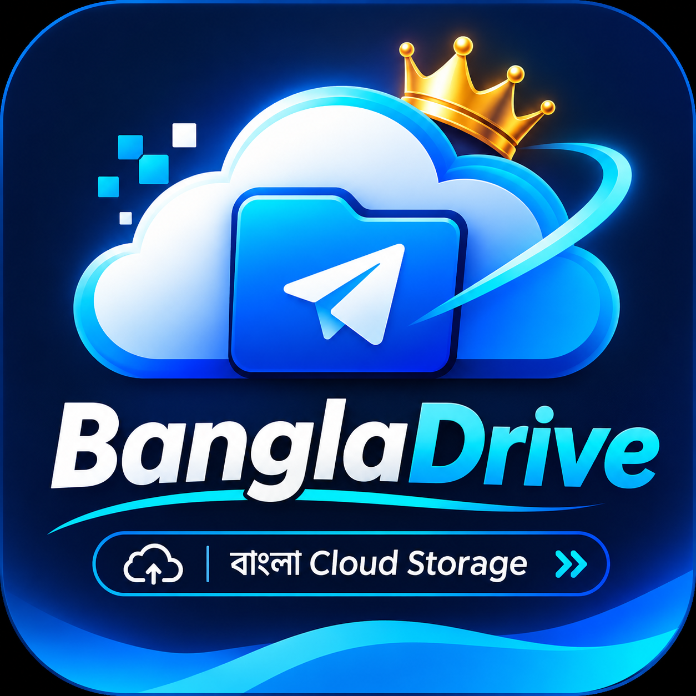
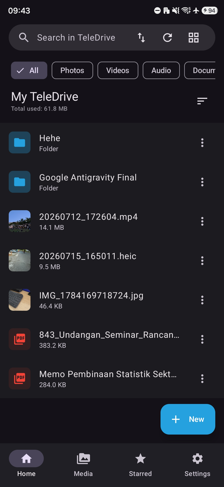
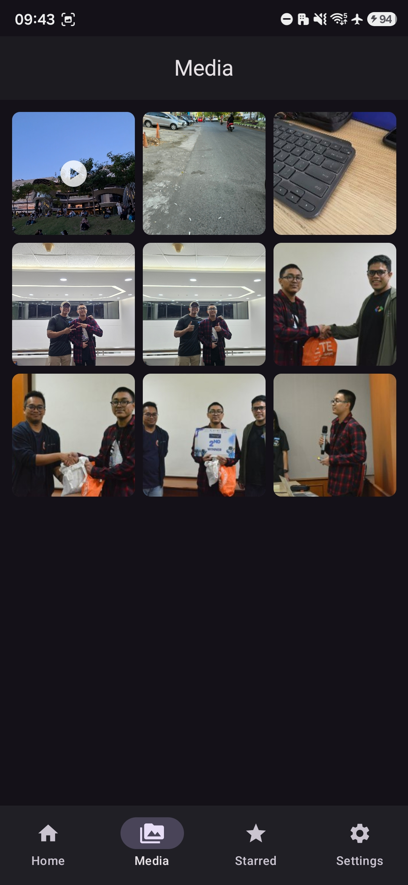
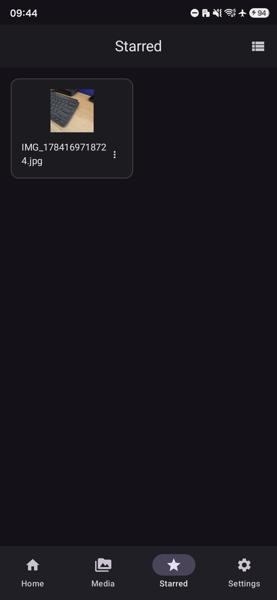

<div align="center">
  
  <h1>BanglaDrive</h1>
  <p><strong>Cloud drive pribadi berbasis Telegram untuk Android.</strong></p>
  <p>
    <a href="https://github.com/Hackershimul07/BanglaDrive/actions"></a>
    
    
    
  </p>
  <p><a href="README.md">English</a></p>
</div>

---

## Tentang BanglaDrive

**BanglaDrive** adalah aplikasi Android untuk mengelola file dan penyimpanan cloud yang memanfaatkan akun Telegram sebagai penyimpanan jarak jauh. Aplikasi ini menggabungkan pengelolaan file/folder, penjelajahan media, transfer, favorit, dan opsi pencadangan otomatis.

> BanglaDrive adalah proyek independen dan tidak berafiliasi dengan atau didukung oleh Telegram.

## Fitur utama

- **Cloud drive Telegram** — jelajahi dan kelola file yang tersimpan melalui akun Telegram.
- **Manajemen file dan folder** — buat folder, cari, urutkan, ubah nama, pindahkan, unduh, bagikan, dan hapus item.
- **Penanganan file besar** — mendukung mekanisme pemisahan file sesuai implementasi aplikasi dan batasan Telegram API.
- **Media** — jelajahi foto, video, dan audio yang didukung.
- **Favorit** — tandai file yang sering digunakan.
- **Transfer** — pantau aktivitas upload dan download.
- **Backup otomatis** — atur pencadangan media/folder di latar belakang menggunakan Android WorkManager.
- **Fitur keamanan** — kunci aplikasi, biometrik pada perangkat yang mendukung, dan perlindungan data lokal.
- **Antarmuka modern** — Material 3 dan Jetpack Compose.

## Screenshot

Screenshot berikut menampilkan UI aplikasi saat ini. Gambar akan diperbarui setelah redesign Premium Dark selesai.

<div align="center">
  
  
  
</div>

## Persyaratan

- Android **7.0 (API 24)** atau lebih baru.
- Akun Telegram aktif.
- `api_id` dan `api_hash` Telegram pribadi dari [my.telegram.org](https://my.telegram.org/).

## Memulai

1. Instal dan buka BanglaDrive.
2. Buat kredensial API di [my.telegram.org](https://my.telegram.org/) → **API development tools**.
3. Masukkan API ID dan API Hash ke aplikasi.
4. Selesaikan login Telegram sesuai instruksi yang ditampilkan.
5. Berikan izin Android yang diperlukan untuk fitur yang ingin digunakan.

**Jaga kerahasiaan kredensial API, kode login, dan kata sandi.** Jangan memasukkannya ke repository atau membagikannya melalui screenshot maupun laporan masalah.

## Build dari source

### Kebutuhan

- Android Studio dan Android SDK yang kompatibel
- JDK 17
- Koneksi internet untuk mengunduh dependensi Gradle pertama kali

### Debug APK

```bash
git clone https://github.com/Hackershimul07/BanglaDrive.git
cd BanglaDrive
chmod +x gradlew
./gradlew :app:assembleDebug
```

APK debug dibuat di `app/build/outputs/apk/debug/`.

### Signed release APK

Konfigurasi signing membaca environment variable berikut:

- `KEYSTORE_PATH`
- `KEY_STORE_PASSWORD`
- `KEY_PASSWORD`
- `ALIAS`

Simpan keystore dan seluruh nilai signing secara privat. Untuk GitHub Actions, gunakan repository Actions secrets. Jangan menaruhnya di source code, README, commit, atau pesan chat.

```bash
./gradlew :app:assembleRelease
```

## Struktur proyek

```text
BanglaDrive/
├── app/src/main/java/com/awd/teledrive/
│   ├── core/        # Utilitas aplikasi dan helper platform
│   ├── data/        # Data lokal, klien Telegram, repository
│   ├── di/          # Dependency injection
│   ├── domain/      # Model domain
│   └── ui/          # Screen Compose, navigasi, dan tema
├── gradle/          # Konfigurasi Gradle wrapper
└── .github/workflows/ # Workflow CI Android
```

## Teknologi

Kotlin · Jetpack Compose · Material 3 · AndroidX Navigation · Hilt · Room · WorkManager · integrasi Telegram TDLib.

## Kontribusi

Laporan bug dan perbaikan yang terarah dipersilakan. Sertakan versi Android/aplikasi dan langkah reproduksi. Hapus informasi sensitif dari log. Jangan pernah melampirkan kode login Telegram, API hash, keystore, password signing, atau file pribadi.

## Disclaimer

BanglaDrive adalah proyek independen dan tidak berafiliasi dengan Telegram. Telegram merupakan merek dagang pemiliknya. Gunakan aplikasi sesuai ketentuan Telegram dan hukum yang berlaku. Ketersediaan cloud, batas ukuran file, dan perilaku API ditentukan oleh Telegram dan dapat berubah.

## Lisensi

Proyek ini menggunakan lisensi yang tercantum dalam [`LICENSE`](LICENSE).
