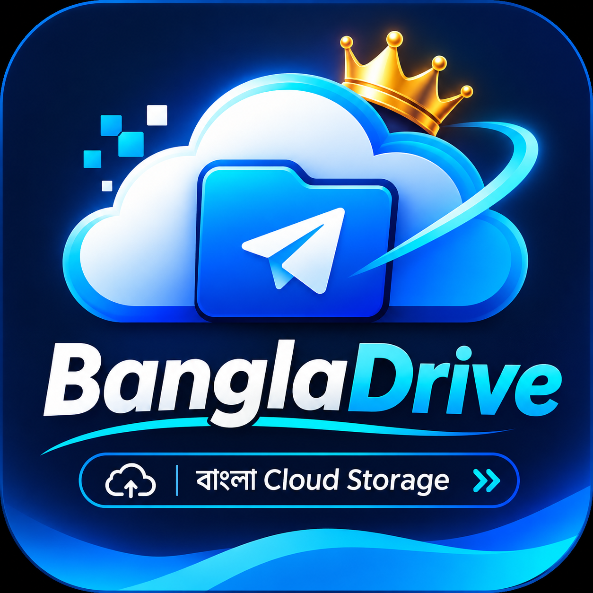
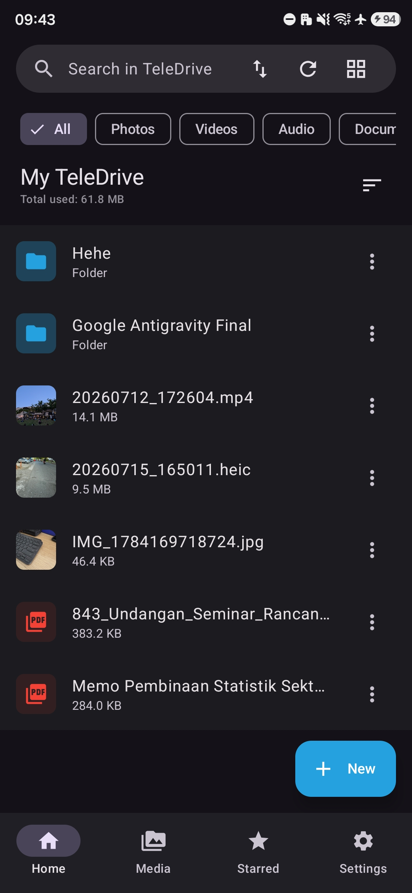
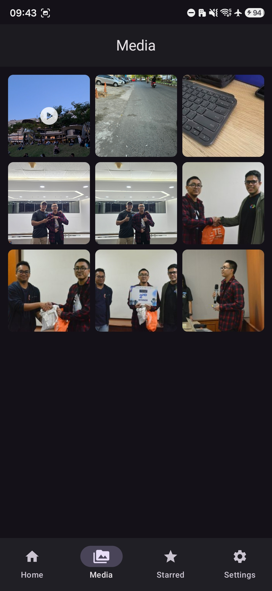
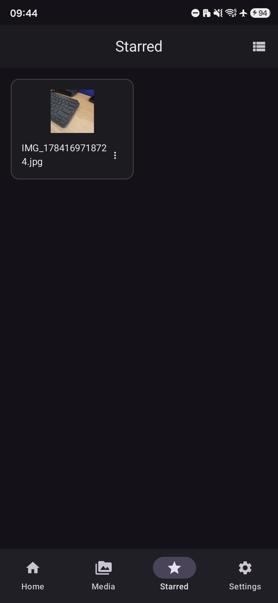

<div align="center">
  
  <h1>BanglaDrive</h1>
  <p><strong>Your personal Telegram-powered cloud drive on Android.</strong></p>
  <p>
    <a href="https://github.com/Hackershimul07/BanglaDrive/actions"></a>
    
    
    
  </p>
  <p><a href="README.id.md">Bahasa Indonesia</a></p>
</div>

---

## Overview

**BanglaDrive** is an Android file manager and cloud-storage client that uses your Telegram account as its remote storage. It combines file and folder management, media browsing, transfers, favourites, and optional background backup in one Android app.

> BanglaDrive is an independent community project. It is not affiliated with or endorsed by Telegram.

## Highlights

- **Telegram cloud drive** — browse and manage files stored through your Telegram account.
- **File and folder management** — create folders, search, sort, rename, move, download, share, and remove items.
- **Large-file handling** — supports split-based handling for files that exceed the usual Telegram upload size limit, subject to the app's implementation and Telegram API constraints.
- **Media library** — browse supported photos, videos, and audio files.
- **Starred items** — keep frequently used files close at hand.
- **Transfers** — view upload and download activity.
- **Automatic backup** — configure background media/folder backup with Android WorkManager.
- **Privacy and security tools** — app lock, biometric unlock where supported, and protected local data features.
- **Modern Android UI** — Material 3 and Jetpack Compose.

## Screenshots

The screenshots below show the current app UI. They will be refreshed as the Premium Dark redesign is completed.

<div align="center">
  
  
  
</div>

## Requirements

- Android **7.0 (API 24)** or newer (the app's configured `minSdk`).
- An active Telegram account.
- Your own Telegram `api_id` and `api_hash` from [my.telegram.org](https://my.telegram.org/).

## Getting started

1. Install and open BanglaDrive.
2. Create Telegram API credentials at [my.telegram.org](https://my.telegram.org/) → **API development tools**.
3. Enter your API ID and API Hash in the app.
4. Complete Telegram sign-in using your phone number and the verification steps shown by Telegram.
5. Grant only the Android permissions needed for the features you want to use.

**Keep your Telegram API credentials, login codes, and passwords private.** Never commit them to this repository or share them in screenshots or issue reports.

## Build from source

### You need

- Android Studio with a compatible Android SDK
- JDK 17
- Internet access for the first Gradle dependency resolution

### Debug APK

```bash
git clone https://github.com/Hackershimul07/BanglaDrive.git
cd BanglaDrive
chmod +x gradlew
./gradlew :app:assembleDebug
```

The debug APK is generated under `app/build/outputs/apk/debug/`.

### Signed release APK

The app's release signing configuration reads these environment variables:

- `KEYSTORE_PATH`
- `KEY_STORE_PASSWORD`
- `KEY_PASSWORD`
- `ALIAS`

Keep the keystore and all signing values private. For GitHub Actions, store them as repository Actions secrets; do not put them in source code, README files, commits, or chat messages. Then run the repository's release build workflow.

```bash
./gradlew :app:assembleRelease
```

## Project structure

```text
BanglaDrive/
├── app/
│   └── src/main/java/com/awd/teledrive/
│       ├── core/        # App utilities and platform helpers
│       ├── data/        # Local data, Telegram client, repositories
│       ├── di/          # Dependency injection
│       ├── domain/      # Domain models
│       └── ui/          # Compose screens, navigation and theme
├── gradle/              # Gradle wrapper configuration
├── .github/workflows/   # Android CI workflows
├── README.md
└── README.id.md
```

## Technology

- Kotlin
- Jetpack Compose + Material 3
- AndroidX Navigation
- Hilt dependency injection
- Room database
- WorkManager
- Telegram TDLib client integration

## Contributing

Bug reports and focused improvements are welcome. Before opening an issue, check whether it already exists. Please include your Android version, app version, clear reproduction steps, and redacted logs. Never attach Telegram login codes, API hashes, keystores, signing passwords, or personal files.

## Disclaimer

BanglaDrive is an independent project and is not affiliated with Telegram. Telegram is a trademark of its respective owner. Use the app in accordance with Telegram's terms and applicable laws. Cloud availability, file-size limits, and API behaviour are controlled by Telegram and may change.

## License

This project is distributed under the license in [`LICENSE`](LICENSE).

<div align="center"><sub>Built with Kotlin and Jetpack Compose · BanglaDrive</sub></div>
